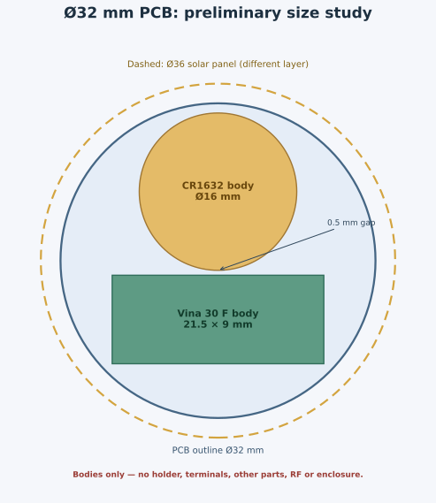

# Premium PCB 配置・配線ドラフト

**評価用試作。実物の一次電池およびハイブリッド蓄電器は接続しない。** 裸基板の試作データは準備したが、部品の定格、回路の安全性、筐体への収納、無線性能またはデモ動作を検証したものではない。[発注データの条件と残課題](fab/README.md)、[回路 README](README.md) の電源保護・保持容量・部品の制約を先に読む。

## 現在の成果物

- [premium_power.kicad_pcb](premium_power.kicad_pcb)：**φ39 mm、2 層、板厚 0.6 mm** の未完成ドラフト。φ36 mm のパネルを維持し、Vina と CR2032 ホルダーを背面に並べるため、旧 φ37 mm から拡げた。最終的なケース内径・パネルの保持・公差は未確認であり、φ39 mm が最終値とは限らない。
- [premium_power.step](premium_power.step)：GND ビアと L2 ランドの 2026-11-06 修正前に KiCad 10 で出力（DNP を除外）。3D モデルが未設定の J2（Vina）、J3（ホルダー）、U1、U103、U108、Q1/Q2 などは含まれない。U2、U105、L1、J1 は指定されたモデルファイルが見つからず、ソーラーパネルのモデルもない。欠けた部品を含む筐体の干渉確認には使えない。
- **SMD 部品は F 面、Vina 30 F と CH005-2032LF 本体は B 面に横並び**とする。両方の足はスルーホールで F 面側から手はんだ付けする。裏面実装の SMD 部品は置かず、B 面の裸 TP、配線、ビアは許容。パッド上ビアもユーザー了承済み。現在のビアは総数 206 個で、そのうち中心が表面 SMD パッド内にあるものは 62 個。はんだ吸い込み、ソルダーレジスト、電池ホルダーとの絶縁は製造・組立条件で確認する。
- J3 に [CH005-2032LF](https://akizukidenshi.com/catalog/g/g108967/) の評価用スルーホール footprint を配置した。メーカー図記載の穴間 26.9 mm／2.54 mm、穴径 φ1.0 mm、2 本側を正極、1 本側を負極としている。2026-11-06、ユーザーからホルダーと Vina の現物について、端子極性・穴位置・リードの曲げを両方確認したとの回答があった。個別の測定値は記録されていない。ホルダー外形 courtyard の一部は寸法図からの近似であり、電池挿抜とケースとの干渉は未検証。
- J2 に Vina VEL08203R8306G の横置き評価用 footprint を配置した。最大本体 21.5 × φ9 mm の側面形状を B 面に置き、穴間 3.5 mm とリードの折り曲げ量を仮定した。上記のとおりユーザーによる現物確認済みだが、測定値は未記録。両者は同じ側なので 9 mm と 5.4 mm を足さない。完成品の厚さ 10 mm は目標であり、PCB、反対面の部品、Solar、ケースと位置ごとの重なりを含めた成立は未確認。
- 裏面の TP 22 個はホルダー・蓄電器の**仮 courtyard 外**に移動した。実際のホルダーの腕、挿抜、ケース、プローブの作業空間までは検証していない。PCB の `Dwgs.User` の φ36 円は uxcell パネルの公称外形の参考線であり、パネル実寸やその固定設計を示さない。J1 はソーラー接続の仮端子。
- [旧 φ37 両面配置・自動配線](drafts/premium_37mm_two_sided_autoroute.kicad_pcb) と [配置のみ](drafts/placement_only.kicad_pcb) は履歴として保存。旧案は現在の組立条件を満たさない。
- BC15M アンテナの両面禁則と BQ の C2・R1〜R5 周辺の銅箔注入禁止領域を設けた。配線後のリーク、ループ、RF とケース内の金属、マイクの裏面音孔は別途確認する。

## 参考：φ31〜32 mm への小径化検討（採用しない）

パネルが公称 φ36 mm でデバイスの外径を決めるため、基板・電池の小型化は優先しない。以下は以前に行った φ31/32 mm の机上比較であり、現行案ではない。半径をそれぞれ 2.5 / 3.0 mm 減らす案で、基板面積は φ37 比で約 25.2% / 29.8% 減る。旧 φ37 両面配置基板を輪郭だけ縮めたコピーでは、元ルールによる KiCad DRC の銅・外周間エラーが φ32 で 157 件、φ31 で 158 件（同一箇所の重複を含む）あり、既存の配置や配線は使えない。電源とアンテナの配置から見直す。



図は同心のパネル・基板に対し、[Vina 30 F](https://akizukidenshi.com/goodsaffix/vel08203r8306g.pdf) 最大本体 21.5 × 9 mm を矩形、[CR1632](https://energy.panasonic.com/dam/master/pdf/jp/datasheet/lithium/CR1632_Datasheet_JP.pdf) 本体最大径 16 mm を円として、他の部品を無視した **2D の例**。φ32 の中心を (0,0) mm とし、Vina 中心を (0,−5.984) mm・長軸を X 方向、CR1632 中心を (0,+7.016) mm に置くと、本体間は 0.5 mm、各本体の最遠部から板端まで約 0.98 mm。ホルダー、電池接点、着脱方向、リード、絶縁、固定、他の部品、配線、RF、筐体壁は含まず、製造上の余裕や組立成立を示さない。

仮に両部品の本体の裏面占有域を固定し、実機接続を J1〜J3 の仮 PTH で表した 77 フットプリントを 0.5 mm 格子で配置する初期探索では、76 個を予約域外に置けた一方、J3 は電池域と干渉した。全体の実配置、電源ループ、配線、実ホルダーと 3D / RF は未検証。貪欲探索の失敗は不可能の証明ではない。J1〜J3 は実コネクタ未選定なので、ケース固定の細線や小型端子へ変更して再検討する。SWD と電源状態・負荷評価の測定点は維持し、重複点は治具への集約を検討する。

CR1632 の候補 [SMTU1632](https://www.takachi-enclosure.com/assets/attachments/images/takachi_coin_cell_battery_holders_25-27.pdf) の最大包絡を 27.65 × 14.5 mm の矩形とすると、その対角は約 31.22 mm。全矩形を PCB 円内に入れる保守的モデルでは φ31 はホルダー単体でも収まらず、φ32 でも板端まで半径方向約 0.39 mm。Vina と同一平面で非重複にする任意角数値探索では、無クリアランスの最良例が外接径約 34.29 mm となり、φ32 の成立例は見つかっていない。矩形包絡は保守的であり、実形状の角の空き、基板外にはみ出してケースで支持する方法や高さ方向を使う方法を否定しない。

小型比較候補の [SMTM1632](https://www.marutsu.co.jp/contents/shop/marutsu/datasheet/takachi_SMTM.pdf) は CR1632 用で約 23.2 × 16.9 × 4.0 mm、SMTU1632 の約 27.65 × 14.5 × 5.4 mm より短く低い一方で幅が広い。マイナス側は基板上の接点等が別途必要。23.2 × 16.9 mm を矩形とみなした Vina との 0.5 mm 離隔の数値探索でも φ32 の成立例は得られていない。実形状、接点の摩耗・導通、振動保持、着脱方向とリードを評価するまで採用しない。なお Vina の本体径 9 mm が全体厚さに効くため、ホルダーの低背化だけで完成品も同量薄くなるとは限らない。

現行の uxcell パネルは公称 φ36 mm で、φ32 PCB より片側 2 mm はみ出す。同心に重ねる場合、パネルを支えるケース・carrier は別設計になる。PCB を φ32 にしても、φ36 パネルを維持した製品の外径を φ31〜32 にできるわけではない。パネル実寸・端子・受け・外壁とアンテナに対する配置は未確認。

## CAD 検査結果と自動配線の限界

2026-11-06、GND ビアと L2 ランドを修正した保存基板を、KiCad 10.0.5 CLI でゾーン再充填・全配線エラー・回路図等価性を確認した。**電気・機構・実装の検証は未完了であり、評価用裸基板のデータである。**

- `HSL` の幅変更後に現れた GND ゾーン間の未接続に対し、GND の貫通ビア（中心 x=81.5、y=100.0 mm、外径 0.6 mm、穴径 0.3 mm、両面テント）を実基板に 1 個追加し、ゾーンを再充填した。銅輪は J3 の仮 courtyard から約 0.6 mm 離れている。現物の機構・絶縁は別途確認する。
- L2 のランドを [Murata DFE201612E の推奨図](https://elektronik.ropla.eu/pdf/stock/mur/dfe201612eseries.pdf) に合わせて各公称 0.8 × 1.8 mm、ランド間 0.8 mm、外端間 2.4 mm に変更した。元の各 0.55 × 1.6 mm／外端間 2.0 mm では公称本体の外側にランドが張り出さない。部品位置とネットは維持し、回路図・生成元・[ローカル footprint](premium.pretty/L_Murata_DFE201612E_Eval.kicad_mod) を揃えた。
- 現基板の未接続 0、PCB DRC エラー 0、回路図との不一致 0。警告は 200 件で、シルク重なり 100、銅上シルク 88、外周との間隔 7、文字高 3、片側だけにつながるビア 1、行き止まり配線 1。ビア警告は `MIC_1V8_SW` (113.575, 93.775) mm、行き止まりは `SEC_GATE` の B.Cu (88.74, 93.21) mm 付近の約 0.01 mm の線。いずれもネット全体は接続済みだが、意図した銅箔か確認する。
- `SOLAR`、`HSL`、`COIN`、`VSTOR_D`、`SEC_GATE`、`PRI_GATE`、`1V8`、マイク電源と TP を含む端子間の未接続は検出されていない。`SOLAR` のネット総延長は約 47.9 mm・5 ビア、`VSTOR_D` は約 6.08 mm・2 ビア。電気的な動作を保証するものではない。
- `HSL` の BQ U1.18 から R8.2 には複数のつながった経路がある。最短の中心線は約 81.5 mm・2 ビアで、幅 0.50 mm が約 69.2 mm、幅 0.15 mm が約 12.2 mm。一方、銅箔の抵抗が最も小さい中心線経路は約 83.0 mm・2 ビアで、幅 0.50 mm が約 82.1 mm、幅 0.15 mm が約 0.9 mm。銅厚 35 µm・20 ℃と仮定した後者の単独経路の銅箔抵抗は約 0.084 Ω（旧経路は約 0.275 Ω）。いずれも TP 分岐、ビア内部、実銅厚・温度・製造公差を含まない概算であり、実際は複数経路に電流が分かれる。蓄電器と BQ `VBAT_SEC` 間の電力経路なので、実負荷で電圧降下と充放電動作を確認する。[BQ25505 datasheet §7.3.2](https://www.ti.com/lit/ds/symlink/bq25505.pdf)
- `LBOOST` は約 7.98 mm・2 ビア。異なる層で `VREF` と投影上交差する箇所があり、短絡ではないが結合・ノイズへの影響は未検証。[TI BQ25505 §10.1](https://www.ti.com/lit/ds/symlink/bq25505.pdf) の電源帰路と制御帰路の分離は未確認。R3・R4 を移動した結果、B.Cu の GND 配線が R3.2 と R4.2 の高抵抗パッドの投影下を通る。異なる層であり短絡ではないが、寄生結合や制御帰路への影響は未評価。高抵抗領域の銅箔注入禁止は維持している。
- `1V8` の配線総延長は約 125.6 mm・14 ビア。C7 は U5 から約 9 mm 離れており、デカップリングと電圧降下・リターンの再評価が必要。ネット全体の配線長は、全電流がその全長を通ることを意味しない。
- Q2 の実装・裏面の PTH と機構は未検証。一次側の C8 は容量未定の 1210 仮 footprint で U4 から遠い。[TPS62840 系](https://www.ti.com/lit/ds/symlink/tps62840.pdf) の部品実寸・フットプリント・過渡動作も未確定。無線の帰路と電源品質も未評価。`UART_TX` のネット総延長は約 72.7 mm・5 ビア。
- ユーザーが R3・R4 と複数の TP を移動した。移動後の裸 TP は J2/J3 の**仮 courtyard と重ならず**、最も近い TP8 と J3 の距離は平面の保守的な包絡比較で約 0.48 mm。現物のホルダー、電池挿抜、プローブ、筐体までの余裕を示すものではない。SW101 の F.Cu ブリッジは保持しているが、操作可能な privacy switch ではない。
- 別途、既定クリアランスを 0.15 mm に引き上げた比較用コピーでは 369 件のクリアランス指摘（同じ近接箇所の重複を含む）。これは**元の 0.10 mm ルールでのエラーではない**。[JLCPCB の公表能力](https://jlcpcb.com/capabilities/pcb-capabilities/)は 2 層・1 oz で最小線幅／間隔 0.10 / 0.10 mm、2 oz は 0.16 / 0.16 mm。JLC で 1 oz を選ぶ場合、銅箔の線幅・間隔だけは公表下限に収まるが、設計は下限ちょうどを含む。見積もり条件とその他の製造・組立制約は別途確認する。比較コピーの設定は本来のプロジェクトに反映していない。
- **DRC エラー・未接続 0 は、電気動作、機構、RF、絶縁、実装、製造の合格を意味しない。** 裸基板の試作と実セルの使用判断を分け、電池保護・機構などの確認前に実セルを接続しない。

設計ルールは Standard 試作版を元にした仮設定で、既定配線 0.15 mm、最小 0.10 mm、代表ビア外径 0.50 / 穴径 0.30 mm、銅箔と基板端 0.20 mm、別パッド間 0.15 mm、PTH 穴と銅箔 0.28 mm など。JLCPCB の公表値と発注候補は [発注データの条件](fab/README.md) を参照。実際の見積もりと DFM は未実施。

再検査（リポジトリルートから）：

```sh
kicad-cli pcb drc --refill-zones --all-track-errors --schematic-parity \
  --format json -o /tmp/premium-pcb-drc.json hw/premium/premium_power.kicad_pcb
python3 hw/premium/check_netlist.py
kicad-cli sch erc -o /tmp/premium-sch-erc.rpt hw/premium/premium_power.kicad_sch
```

DRC の再充填結果を基板にも保存する場合のみ `--save-board` を加える。回路図 ERC は LM66100 の未使用 ST と GND に関する既知の 2 errors、0 warnings が残る。

## PCB を確定する前に行うこと

1. **実装・機構。** ユーザーは CH005 と Vina の現物を確認済みと回答。ホルダー・リードの確認結果と B 面の穴・極性の一致、はんだ付け、絶縁、電池の挿抜とプローブのアクセスを確認する。φ36 パネルの固定、ワイヤ、RF、MJF 筐体の干渉と厚さを 3D と現物で確認する。
2. **配線。** 行き止まりのビア・線を確認し、BQ と TPS のデカップリング・電源ループ、高抵抗部、`HSL` の経路を評価する。製造先の銅箔間隔・ビア・基板厚の条件を確認し、露出 TP に組立後あるいは分解時にアクセスする方法を用意する。
3. **非常用 24 時間。** CR2032 の電池側平均電流と、起動・録音・NAND・BLE を含む使用時の電圧降下を確認する。D1/R6 は実電池の保護として未承認、C8 は未選定。使用容量・保持・切替と逆電流の検証前に実電池・実蓄電器を接続しない。電源設計ゲート を参照。
4. **実装仕上げ。** Q1/Q2 の F.Paste 開口、U2 と NAND EP、コンデンサ実効容量、実 privacy switch、ADC 逆給電、製造先の制約と Gerber を確認する。
